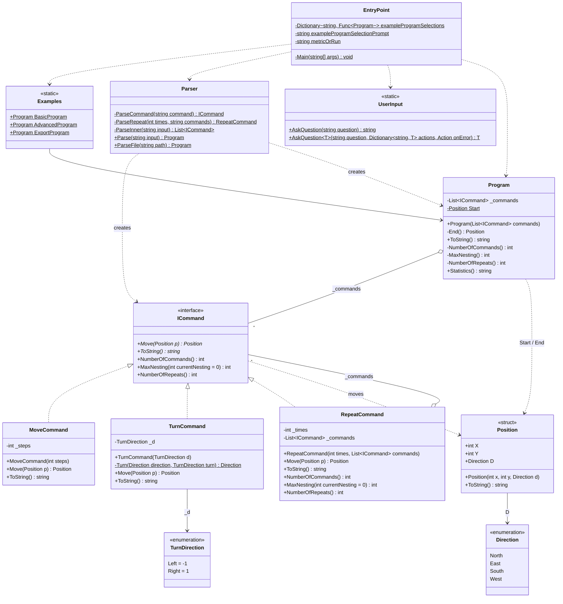

# Class Diagram

# Classes

## ICommand

Every command with the Move function, that applies the command to the current position.
The `NumberOfCommands`, `MaxNesting` and `NumberOfRepeats` functions are only there for the nested case that exists for repeat commands.

## Program

Contains a sequence of commands that can either be executed to obtain the final positon or to be analyzed for the metrics.
Has a Position start, which can be used/ changed in the future to assign a dynamic starting position.

## Examples

Static class that contains three basic programs, defined here, rather then cluttering the main class.

## UserInput

Abstraction layer between the user and the program. Can ask questions and get an input or couple the input to an action directly.

## Parser

Parses input files, that have the following styling rules: - Repeats nested by 4 spaces - White lines ignored - One space between command and property with nothing following afterwards - Ran top to bottom

## EntryPoint

Basic C# entrypoint that just asks the user for their desired action.
